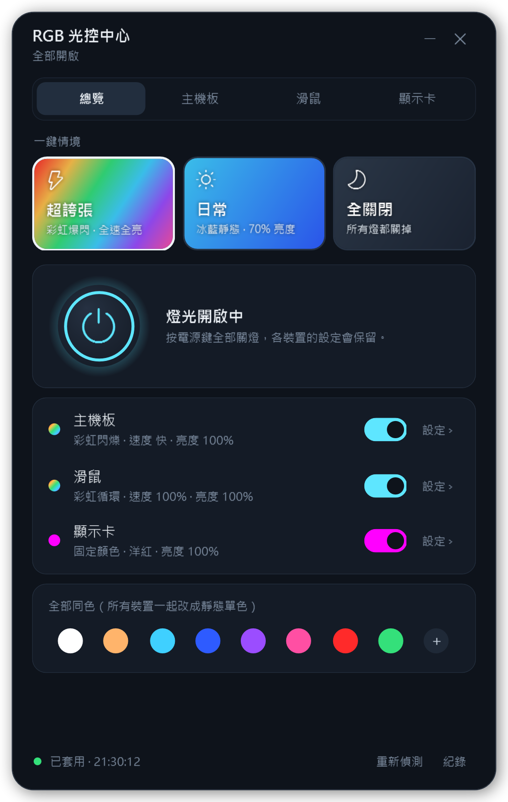
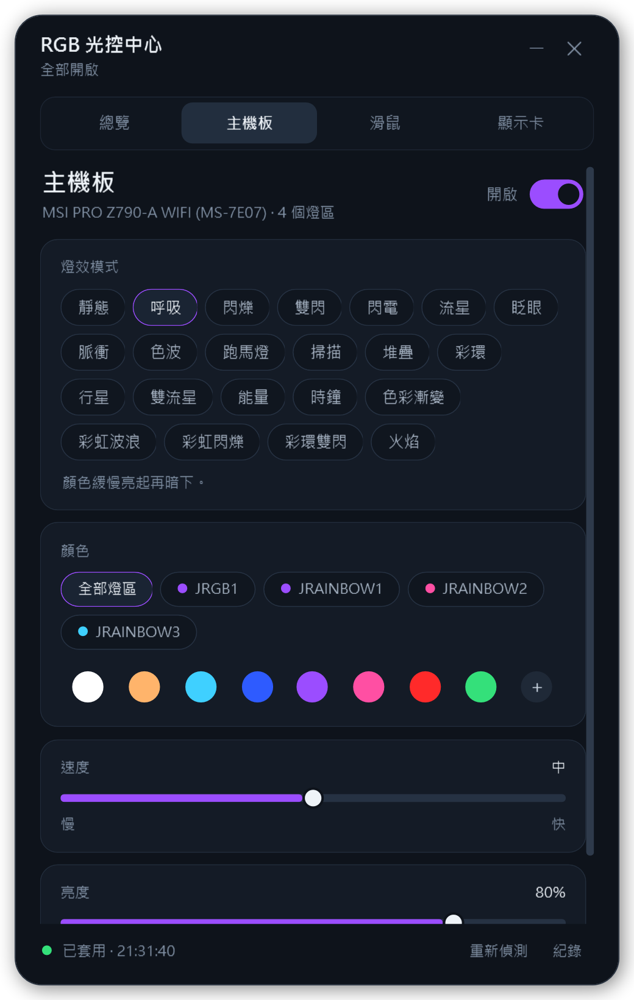
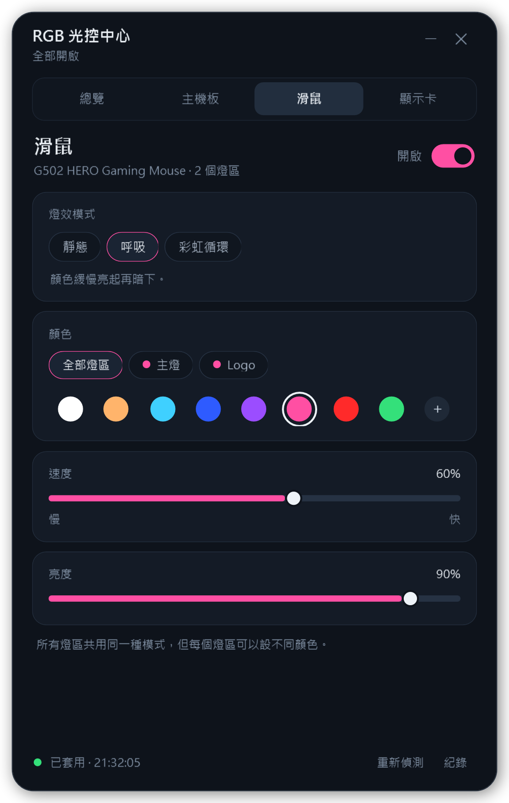
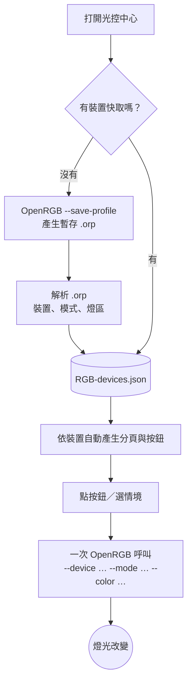

<p align="center">
  
</p>

<p align="center">
  
  
  
  
  
</p>

<p align="center">
  <b>一個給 Windows 用的 RGB 燈光控制面板。</b><br>
  透過 <a href="https://openrgb.org">OpenRGB</a> 控制主機板、顯示卡、滑鼠、鍵盤、燈條……<br>
  把 OpenRGB 複雜的設定，收成幾顆好按的按鈕。
</p>

---

## 畫面

<table>
  <tr>
    <td align="center" width="33%"><br><sub><b>總覽</b>：一鍵情境、全部開關、每個裝置的狀態</sub></td>
    <td align="center" width="33%"><br><sub><b>裝置分頁</b>：22 種模式、分燈區設色、速度與亮度</sub></td>
    <td align="center" width="33%"><br><sub><b>不支援的選項自動隱藏</b>：每個裝置只顯示它做得到的</sub></td>
  </tr>
</table>

## 特色

| | |
| --- | --- |
| 🔍 **自動偵測** | 第一次打開時讀取電腦裡有哪些 RGB 裝置、各自支援哪些燈效，介面依結果自動產生。換一台電腦也能直接用。 |
| ⚡ **一鍵情境** | **超誇張**（每個裝置挑最炫的模式、全速全亮）、**日常**（冰藍靜態、70% 亮度）、**全關閉**。 |
| 🎛️ **每個裝置一個分頁** | 選模式（靜態、呼吸、閃爍、彩虹……）、顏色、速度、亮度；多燈區的裝置可以每區設不同顏色，也能開隨機色。 |
| ⏻ **全部開關** | 一顆電源鍵關掉所有燈，再按一次恢復原本的設定。 |
| 🚀 **不卡畫面** | 燈控在背景執行，所有裝置合併成一次 OpenRGB 呼叫，大約 2 秒生效。 |
| ⌨️ **命令列** | 不開視窗也能執行，適合綁快捷鍵或工作排程器。 |

## 技術棧

<p>
  
  
  
  
  
</p>

| 層 | 用什麼 | 做什麼 |
| --- | --- | --- |
| 介面 | **WPF + XAML**（由 PowerShell 載入） | 深色視窗、分頁、情境卡片、滑桿、開關 |
| 邏輯 | **Windows PowerShell 5.1** | 狀態管理、背景排程、命令列模式 |
| 硬體 | **OpenRGB 命令列** | 偵測裝置、切換模式與顏色 |
| 偵測 | **自寫的 `.orp` 解析器** | 讀出每個裝置的模式、燈區、速度／亮度範圍 |
| 啟動 | **VBScript** | 開啟視窗時不跳出黑色主控台 |

不需要安裝 Node、Python 或 .NET SDK：Windows 內建的 PowerShell 就能跑。

## 運作方式



## 需求

- Windows 10 / 11
- [OpenRGB](https://openrgb.org) 0.9 以上，安裝在預設位置；或第一次開啟時手動指定 `OpenRGB.exe`

## 安裝

1. 下載或 `git clone` 這個資料夾，放在一般使用者可以寫入的位置（例如 `文件` 底下）。設定和紀錄會存在同一個資料夾。
2. 在資料夾裡執行一次，建立桌面捷徑：

   ```powershell
   powershell -ExecutionPolicy Bypass -File .\Install-Shortcut.ps1
   ```

3. 雙擊桌面上的「RGB 光控中心」。

> [!IMPORTANT]
> 使用前請先關掉 OpenRGB 主程式（包含系統匣圖示）。它開著時會和這個工具搶裝置控制權，可能把這裡的設定蓋掉。

## 命令列

```powershell
.\RGB-CommandCenter.ps1 -Action Off      # 全部關燈
.\RGB-CommandCenter.ps1 -Action On       # 全部開燈（恢復上次設定）
.\RGB-CommandCenter.ps1 -Action Toggle   # 開關切換
.\RGB-CommandCenter.ps1 -Action Daily    # 日常情境
.\RGB-CommandCenter.ps1 -Action Crazy    # 超誇張情境
.\RGB-CommandCenter.ps1 -Action Apply    # 重新送出目前的設定
.\RGB-CommandCenter.ps1 -Action Scan     # 重新偵測裝置
```

## 安全性

- 偵測只是請 OpenRGB 列出裝置，和 OpenRGB 每次執行指令前做的偵測相同，不會寫入任何韌體。
- 這個工具只切換燈效模式，不會主動要求裝置把設定寫進永久記憶。（少數裝置的硬體本身會自動保存最後的燈效，這是裝置自己的行為。）
- 程式本身不會連網、不會下載任何東西（唯一例外：找不到 OpenRGB 時按「下載 OpenRGB」，會用瀏覽器打開官網），也不會修改登錄檔或系統設定；只會讀寫自己資料夾裡的設定與紀錄檔，以及系統暫存資料夾裡的一個暫存檔（用完即刪）。
- 只會執行檔名為 `OpenRGB.exe` 的程式。

> [!TIP]
> **建議用一般權限執行。** 以系統管理員身分執行時，OpenRGB 會額外掃描 SMBus／I2C 匯流排（記憶體燈條等），這部分在少數硬體上曾造成問題。一般權限下這部分會自動跳過，紀錄裡看到 `PawnIO initialization aborted` 屬正常。

## 檔案

| 檔案 | 用途 |
| --- | --- |
| `RGB-CommandCenter.ps1` | 主程式（視窗＋命令列） |
| `RGB-CommandCenter.vbs` | 不跳黑色主控台視窗的啟動器 |
| `Install-Shortcut.ps1` | 建立桌面捷徑 |
| `docs/` | README 用的圖片 |
| `RGB-devices.json` | 偵測結果快取（自動產生，不會進版本控制） |
| `RGB-switch-state.json` | 各裝置的設定（自動產生，不會進版本控制） |
| `RGB-CommandCenter.log` | 執行紀錄（自動產生，不會進版本控制） |

## 授權

[MIT](LICENSE)。OpenRGB 本身是 GPL-2.0；這個專案只呼叫它的執行檔，沒有包含或修改 OpenRGB 的程式碼，請另外從[官方網站](https://openrgb.org)安裝。
